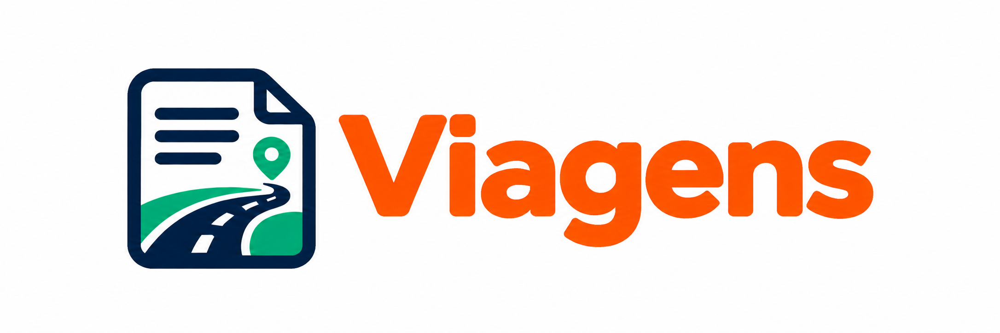

[Português](README.md) | [English](README.en.md) | [Español](README.es.md)

# Folha de Viagem

**Case study · Web application under development · Armand Marques Filho**

## The problem

Organising journey and expense records for road transport fleets, making them available for review and supporting monthly reporting.

## Proposed solution

An application for recording journeys, linking expenses and providing access according to user roles. These features are the product's intended scope and are not yet fully implemented.

## My contribution

Requirements gathering and organisation, data modelling studies, technical documentation, development environment setup and initial interface implementation.

## Current state of this edition

| Area | Status |
| --- | --- |
| Next.js foundation with App Router, React and TypeScript | Configured in the internal project. |
| Tailwind CSS, local fonts and visual identity | Added to the project foundation. |
| Interface | Initial form with name, email and registration button. |
| Requirements, modelling and technical manual | Documented in the internal project. |
| APIs and data persistence | Next steps; manual examples are guidance. |
| Authentication and authorisation | Planned; not implemented in this edition. |
| Automated testing and continuous integration | To be developed. |
| Public prototype | Interactive, with demonstration data and no backend. |

## Interactive prototype

[**Open the prototype in your browser**](https://servicesn2019-code.github.io/Folha-de-Viagem-Portfolio/prototipo/) · [Initial prototype PDF (historical version)](prototipo/Prototipo_Folha_de_Viagem_v1.pdf)

The prototype presents overview, journeys, expenses and reports screens, using demonstration data and simulated interactions to validate the proposed user experience and workflows.

The screens are in Portuguese. There is no authentication or database connection; journey entries added through the interface are temporary and disappear on reload. The prototype is separate from the Next.js application under development.

## Technologies

Next.js · React · TypeScript · Tailwind CSS · Git/GitHub.

Database integration and APIs will be documented as implemented only after delivery and validation.

## Organisation and decisions

- The foundation uses the Next.js App Router.
- The application is developed in TypeScript.
- Fonts are kept locally in the project.
- Development, testing, staging and production have separate areas in the internal repository.
- The public presentation is separate from internal project documents.

[Read the intended architecture and next steps](docs/Architecture_and_Evolution.en.md)

## Next deliverables

- [ ] Define and implement data persistence.
- [ ] Complete a create, read, update and delete workflow with validation.
- [ ] Implement authentication and authorisation by role and record.
- [ ] Add tests for key rules and build verification.
- [ ] Publish a demo with fictional data and screenshots of delivered interfaces.

## About this presentation

First public edition: 15 November 2026. Content selected for a portfolio, without financial documents, credentials or real operational data. Updates to this showcase are independent of the internal repository.

## Author and contact

**Armand Marques Filho — FullStack Developer**

[GitHub profile in English](https://github.com/servicesn2019-code/servicesn2019-code/blob/main/README.en.md) · [Contact](mailto:servicesn2019@gmail.com)

Owner of the N-Services brand, a future company currently in the research and planning stage.

## Licence

The prototype includes the MIT licence from the original project. See [LICENSE](LICENSE).
