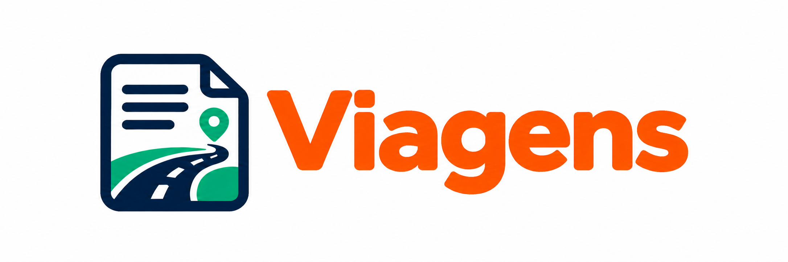

[Português](README.md) | [English](README.en.md) | [Español](README.es.md)

# Folha de Viagem

**Caso de estudio · Aplicación web en desarrollo · Armand Marques Filho**

## El problema

Organizar los registros de viajes y gastos de flotas de transporte por carretera, facilitar su consulta y apoyar la elaboración de informes mensuales.

## Propuesta

Desarrollar una aplicación para registrar viajes, asociar gastos y ofrecer consultas según el perfil de acceso. Estas funcionalidades constituyen el objetivo del producto y todavía no están implementadas en su totalidad.

## Mi participación

Recopilación y organización de requisitos, estudios de modelado de datos, documentación técnica, preparación del entorno de desarrollo e implementación inicial de la interfaz.

## Estado verificable de esta edición

| Área | Estado |
| --- | --- |
| Base Next.js con App Router, React y TypeScript | Configurada en el proyecto interno. |
| Tailwind CSS, fuentes locales e identidad visual | Incorporados a la base del proyecto. |
| Interfaz | Formulario inicial con nombre, correo y botón de registro. |
| Requisitos, modelado y manual técnico | Documentados en el proyecto interno. |
| API y persistencia de datos | Próximas etapas; los ejemplos del manual son orientaciones. |
| Autenticación y autorización | Planificadas, todavía sin implementar en esta edición. |
| Pruebas automatizadas e integración continua | Pendientes de desarrollo. |
| Prototipo público | Navegable, con datos de demostración y sin backend. |

## Prototipo navegable

[**Abrir el prototipo en el navegador**](https://servicesn2019-code.github.io/Folha-de-Viagem-Portfolio/prototipo/Prototipo_Folha_de_Viagem_v1.8.es.html) · [PDF de la versión inicial (archivo histórico)](prototipo/Prototipo_Folha_de_Viagem_v1.pdf)

**Rutas** es la versión en español de la demostración para empleados. Incluye acceso simulado, registro y edición de viajes, consulta personal, informe mensual imprimible, registro y consulta de consumos y solicitudes de cambio de datos de contacto. Las fechas se muestran como **23/11/2026** en la consulta y el informe.

Busque a **Ana Martins** y use la contraseña de demostración **1234**. Los datos de ejemplo se restablecen al recargar la página. [Demostración anterior](https://servicesn2019-code.github.io/Folha-de-Viagem-Portfolio/prototipo/index.es.html).

### PDF actual del empleado — v1.9

[PDF actual del empleado — v1.9](prototipo/pdf/Prototipo_Condutor_ES.pdf)

### PDF históricos — versión 3.0

[Gestor — PDF histórico](prototipo/pdf/Prototipo_Gestor_ES.pdf) · [Conductor — PDF histórico](prototipo/pdf/Prototipo_Condutor_ES_v3.0.pdf)

## Tecnologías

Next.js · React · TypeScript · Tailwind CSS · Git/GitHub.

La integración con la base de datos y las API se documentarán como implementadas únicamente después de su entrega y validación.

## Organización y decisiones

- La base utiliza el App Router de Next.js.
- La aplicación se desarrolla en TypeScript.
- Las fuentes se mantienen localmente en el proyecto.
- Los entornos de desarrollo, pruebas, homologación y producción tienen espacios separados en el repositorio interno.
- La presentación pública está separada de los documentos internos del proyecto.

[Consultar la arquitectura prevista y los próximos pasos](docs/Arquitectura_y_Evolucion.es.md)

## Próximas entregas

- [ ] Definir e implementar la persistencia de datos.
- [ ] Completar un flujo de alta, consulta, modificación y eliminación con validaciones.
- [ ] Implementar autenticación y autorización por perfil y por registro.
- [ ] Añadir pruebas de las reglas principales y verificación de compilación.
- [ ] Publicar una demostración con datos ficticios y capturas de las interfaces entregadas.

## Sobre esta presentación

Primera edición pública: 15 de noviembre de 2026. Contenido seleccionado para el portafolio, sin documentos financieros, credenciales ni datos operativos reales. Las actualizaciones de esta presentación son independientes del repositorio interno.

## Autor y contacto

**Armand Marques Filho — Desarrollador FullStack**

[Perfil de GitHub en español](https://github.com/servicesn2019-code/servicesn2019-code/blob/main/README.es.md) · [Contacto](mailto:servicesn2019@gmail.com)

Propietario de la marca N-Services, futura empresa en fase de estudio y planificación.

## Licencia

El prototipo incluye la licencia MIT del proyecto original. Consulta [LICENSE](LICENSE).
