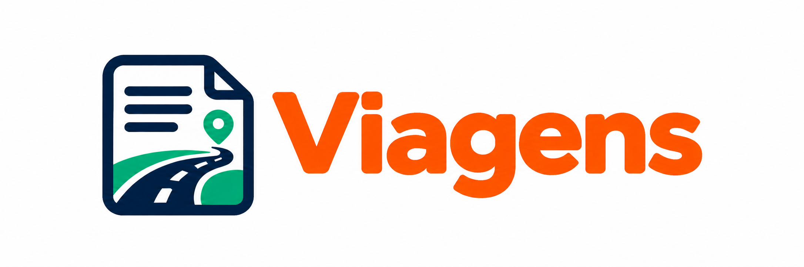

[Português](README.md) | [English](README.en.md) | [Español](README.es.md)

# Folha de Viagem

**Estudo de caso · Aplicação web em desenvolvimento · Armand Marques Filho**

## O problema

Organizar registros de viagens e despesas de frotas rodoviárias e apoiar sua consulta e a preparação de relatórios mensais.

## Proposta

Desenvolver uma aplicação que permita registrar operações de viagem, relacionar despesas e disponibilizar consultas conforme o perfil de acesso. Essas funcionalidades constituem o objetivo do produto e ainda não estão integralmente implementadas.

## Minha atuação

Levantamento e organização de requisitos, estudos de modelagem de dados, documentação técnica, preparação do ambiente de desenvolvimento e implementação inicial da interface.

## Estado verificável desta edição

| Área | Situação |
| --- | --- |
| Base Next.js com App Router, React e TypeScript | Configurada no projeto interno. |
| Tailwind CSS, fontes locais e identidade visual | Adicionados à base do projeto. |
| Interface | Formulário inicial com nome, e-mail e botão de registro. |
| Requisitos, modelagem e manual técnico | Documentados no projeto interno. |
| APIs e persistência de dados | Próximas etapas; os exemplos do manual são orientações. |
| Autenticação e autorização | Planejadas, ainda sem implementação nesta edição. |
| Testes automatizados e integração contínua | A desenvolver. |
| Protótipo público | Navegável, com dados de demonstração e sem backend. |

## Protótipo navegável

[**Abrir o protótipo no navegador**](https://servicesn2019-code.github.io/Folha-de-Viagem-Portfolio/prototipo/) · [PDF da versão inicial (arquivo histórico)](prototipo/Prototipo_Folha_de_Viagem_v1.pdf)

O protótipo apresenta as telas de visão geral, viagens, despesas e relatórios, com dados de demonstração e interações simuladas. Foi criado para validar a experiência e os fluxos propostos.

As telas estão em português. Não há autenticação nem conexão com banco de dados; os registros de viagem adicionados na interface são temporários e desaparecem ao recarregar a página. O protótipo é separado da aplicação Next.js em desenvolvimento.

## Tecnologias

Next.js · React · TypeScript · Tailwind CSS · Git/GitHub.

A integração com banco de dados e as APIs serão documentadas como implementadas somente após sua entrega e validação.

## Organização e decisões

- A base utiliza o App Router do Next.js.
- A aplicação é desenvolvida em TypeScript.
- As fontes são mantidas localmente no projeto.
- Os ambientes de desenvolvimento, testes, homologação e produção têm espaços separados no repositório interno.
- A apresentação pública fica separada dos documentos internos do projeto.

[Consultar arquitetura pretendida e próximos passos](docs/Arquitetura_e_Evolucao.md)

## Próximas entregas

- [ ] Definir e implementar a persistência de dados.
- [ ] Concluir um fluxo de cadastro, consulta, alteração e exclusão com validações.
- [ ] Implementar autenticação e autorização por perfil e por registro.
- [ ] Adicionar testes das regras principais e verificação de build.
- [ ] Publicar uma demonstração com dados fictícios e capturas das telas entregues.

## Sobre esta apresentação

Primeira edição pública: 15/11/2026. Conteúdo selecionado para portfólio, sem documentos financeiros, credenciais ou dados operacionais reais. As atualizações desta vitrine são independentes do repositório interno.

## Autor e contato

**Armand Marques Filho — Desenvolvedor FullStack**

[Perfil GitHub](https://github.com/servicesn2019-code) · [Contato](mailto:servicesn2019@gmail.com)

Proprietário da marca N-Services, futura empresa em fase de estudos e planejamento.

## Licença

O protótipo acompanha a licença MIT do projeto de origem. Consulte [LICENSE](LICENSE).
